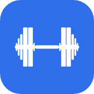
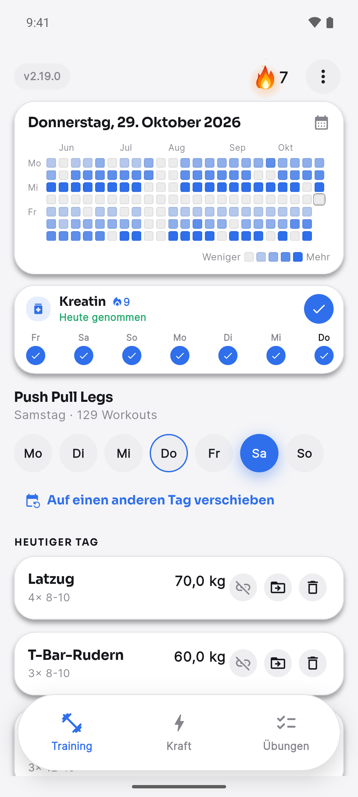
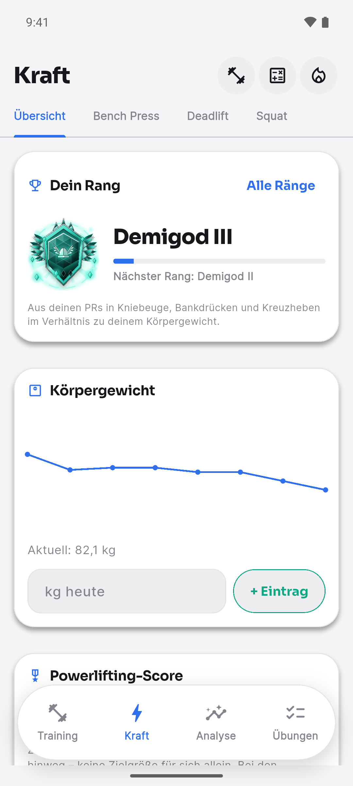
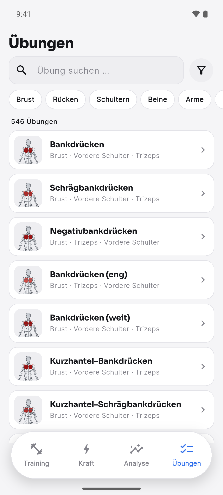

<div align="center">



# Kilo

**A workout planner, strength tracker, and analytics tool — built as a
native app for Android, iOS, Windows, and macOS.** All your data stays
**100% on your device**: no cloud, no server, no account, no tracking.

[](https://github.com/Sieder2009/GymTracker/actions/workflows/android.yml)
[](https://github.com/Sieder2009/GymTracker/actions/workflows/ios.yml)
[](https://github.com/Sieder2009/GymTracker/actions/workflows/windows.yml)
[](https://github.com/Sieder2009/GymTracker/actions/workflows/macos.yml)


[](https://sieder2009.github.io/GymTracker/)

</div>

---

##  Contents

- [What is Kilo?](#what-is-kilo)
- [Screenshots](#screenshots)
- [Features](#features)
  - [Training & home screen](#training)
  - [Strength & ranks](#strength)
  - [Exercise database](#exercise-database)
  - [Settings & more](#more-features)
- [Download the app](#download-the-app)
- [Setup for developers](#setup-for-developers)
- [Configuration (`.env`)](#configuration-env)
- [Tests & code quality](#tests--code-quality)
- [Project structure](#project-structure)
- [Privacy](#privacy)
- [Credits](#credits)

---

##  What is Kilo?

Kilo (formerly Ironpeak Fitness) is one single, native **Flutter app**. It
is not a web app with a separate build, and not an Electron app. One
codebase runs on **Android, iOS, Windows, and macOS**. The app is built
around **three main tabs**, so you don't need to search through many menus:

| Tab | What it's for |
|---|---|
| **Training** | Your home screen: training calendar, creatine tracker, today's plan; choose/create/import a plan |
| **Strength** | Bench Press / Deadlift / Squat: ranks, PRs, history, trend, DOTS, body measurements, plus 1RM, plate and calorie calculators |
| **Exercises** | A searchable database of 546 exercises with muscle diagrams and demo animations |

The calendar, photo gallery, settings, backup, theme, and language are
**not** extra tabs at the bottom. They live together in one ⋮ menu at the
top right of the Training tab. Strength and Exercises have a ⋮ menu of
their own with just the three calculators (plate, 1RM, calorie), which
the Training menu lists too. The app version sits as a small pill at the
top left; when an update is available it turns into a "↑ vX.Y.Z" button.

##  Screenshots

<table>
<tr>
<td width="33%"></td>
<td width="33%"></td>
<td width="33%"></td>
</tr>
<tr>
<td align="center"><sub><b>Training</b></sub></td>
<td align="center"><sub><b>Strength</b></sub></td>
<td align="center"><sub><b>Exercises</b></sub></td>
</tr>
</table>

> Real captures from the Android emulator (Pixel 7, Android 15) with the
> demo data from `mobile/tool/seed_demo_data.dart`, app language German.

## Features

<a id="training"></a>
###  Training & home screen

- **The home screen** starts with today's date and a **GitHub-style
  training calendar** of the last few months (tap it, or any day, for the
  full calendar). Below it sits a compact **creatine tracker**: one tap
  ticks off today, the last seven days are small dots you can fix
  afterwards, and a 🔥 shows how many days in a row you've taken it.
- At the top right burns your **training streak** as an animated flame
  with the number of days: it grows with the streak (full size from about
  two months), throws sparks from three days on and gets a white-hot core
  from 30 — grey and small at zero. Rest days from your plan don't break
  it; a tap opens the calendar (`widgets/streak_flame.dart`).
- Then **today's plan**: day pills to look at any weekday, "Move to
  another day" to reschedule a session just once or to move a day's
  exercises to another weekday for good (onto a training day, the two
  days swap), today's exercises plus the ones
  you do on every training day — drag to reorder, link two exercises into
  a **superset**, move an exercise to another day.
- Two parts are **optional** and off by default — turn them on under
  Settings → Home screen: a "Next workout" card (number of exercises and
  estimated duration) and the **"Start workout"** button for the guided
  session.
- Workout plans by weekday or rotation. Create them by hand, import a plan
  from your own log format, or pick one of eight built-in templates
  (shown during onboarding on first launch).
- **Guided workouts** with set-by-set input, a live session timer, and
  RPE *or* RIR for each set (your choice in Settings). Exercises can be
  logged by reps, **timed** (planks, holds) or as **cardio** (minutes and
  speed), and **unilateral** exercises per side. You can reorder exercises
  during a session without changing your saved plan.
- The rest timer uses real clock time, not a simple countdown. It syncs
  right away when you return from the background and sends a local push
  notification when it ends — it stays accurate no matter how long your
  phone was locked.
- Enter weight with a **slider or the keyboard** (comma or dot as the
  decimal separator), as a total or per side of the bar (bar weight is
  set in Settings).
- **Progressive overload suggestions.** Every exercise with logged history
  gets a plain-language nudge for what to try next session, saying why —
  double progression against each set's target from your plan: every set
  at the top bumps the weight (+2.5kg, +5kg for leg exercises); anything
  short of that keeps the weight and gives one more rep per set to aim for
  ("Stay at 100 kg. Last time 8 · 7, target 10 — next time try 9 · 8.");
  only two sessions in a row with every set at least three reps under the
  target suggest a lighter weight, the one that fits the target by the
  estimated 1RM (`analytics/progression_engine.dart`). Built only from
  real rep counts you logged — never a guess from a '✓'/'x'/'m' marker or
  an empty set.
- **Every exercise keeps its history** in one compact card: best estimated
  1RM (Epley) and the 30-day trend, a chart of the estimated 1RM per
  session, the suggestion for next time, and the sessions as a list —
  date, weight, reps per set — showing the latest five until you expand
  it (`widgets/exercise_analytics_section.dart`). Saved something wrong?
  Tap the entry to correct its weight and sets or delete it; the working
  weight for next time follows (`widgets/history_entry_sheet.dart`).
- **Animated exercise demos.** 354 of the 546 exercises in the database
  show a short animation of how the movement is done: in the Exercises
  tab, in the exercise editor, during a guided workout, and as an
  "up next" preview while you rest. The animations are third-party media
  that the app loads on demand and never bundles. See
  [Exercise animations](#exercise-animations) for where they come from.
- The **full training calendar**: every day of the last 12 months is a
  small square, shaded by that day's training volume or time, with
  GitHub's five levels and "Less … More" legend, a year selector and your
  current and best streak, this month's workouts and a bar chart of
  workouts per week. Rest days from your plan don't break a streak.
  Tapping a day shows its sessions. Open it by tapping the calendar on the
  home screen, the streak flame, or the ⋮ menu. There's also a photo
  gallery for your progress.
- Swipe between the three main tabs, or use the tab bar at the bottom.

<a id="strength"></a>
###  Strength & ranks

The Strength tab is one overview. Tap the **Bench Press, Deadlift or
Squat** tile (weight and rank, below the Powerlifting Score) to open that
lift's own page. The three calculators sit in its ⋮ menu.

- **Ranks.** Every lift gets a game-style rank from your PR relative to
  your bodyweight: **Mortal, Warrior, Spartan, Hero, Demigod, Titan and
  Olympian**, each split into divisions III–I (Olympian has none). Each
  rank is an animated crystal badge with a symbol from Greek myth — skull,
  crossed axes, Corinthian helmet, Greek hero, winged helmet, Atlas and
  Zeus (`widgets/rank_emblem.dart`). The Overview shows your **overall
  rank** (the average of the three) with a progress bar to the next
  division and an "All ranks" list; each lift's page also tells you how
  many kilograms are still missing. Built on bodyweight-relative strength
  standards (`data/lift_rank.dart`, `data/strength_standards.dart`).
  Ranks need a logged bodyweight.
- Log your bodyweight, your **body measurements** (chest, waist, hips,
  arm, thigh, calf — a trend chart per field and a radar chart of first
  vs. latest value) and your PRs. The three PRs also appear as a
  **radar chart** on one shared kg scale, with one place to enter all
  three at once.
- Total (Bench+Deadlift+Squat) and **DOTS score** for anyone who wants the
  bodyweight-normalized comparison number competitive powerlifters use
  (`data/dots_score.dart`).
- A **lift balance** check: is your bench press around 0.65–0.85× and
  your deadlift around 1.1–1.35× your squat? (`data/lift_balance.dart`)
- Each lift's own page: its rank badge and progress, a date-based trend
  chart with a 4W/3M/6M/1Y/All range selector, its 30-day trend, plateau
  detection (`plateau_notice.dart`), PR entry, and the logged history as
  a list.
- Three built-in calculators, all scratchpad tools that don't read or
  write your logged data: a **1RM calculator** (Epley formula), a **plate
  calculator** with two modes: give it a target weight and an empty
  weight (the bar from Settings, or 0 for a leg press) and it works out
  which plates go on each side, using only the plates you've switched on
  (say, a gym without 20s) and searching exactly, so 30 kg a side from
  25s and 15s comes out as 15+15 (`data/plate_calculator.dart`); or tap
  the plates you load on one side (20, then 10, then 25 …) and it adds
  them up to the total — and a **calorie & macro calculator**
  (Mifflin-St Jeor with an activity level and a goal of losing,
  maintaining or gaining; `data/calorie_calculator.dart`).

<a id="exercise-database"></a>
###  Exercise database

- 546 exercises, sorted by category (chest/back/shoulders/legs/arms/
  core/cardio), searchable and filterable by muscle in the "Exercises"
  tab. Each one has a muscle activation mapping based on exercise science
  (`lib/data/exercise_muscle_map.dart`).
- An exercise's page shows the **muscles worked** first, then the demo
  animation, then the how-to text under a "?" header with a video link
  below it.
- The database **loads live from GitHub** (it falls back to the last
  cached copy, or the built-in copy, if you're offline). Changes to
  `mobile/assets/exercises.json` in this repo update the app without a
  new release.
- **Animated demos for 354 exercises.** Which animation belongs to which
  exercise is set in `lib/data/exercise_gifs.dart`, keyed by exercise id.
  Every entry there was matched by movement *and* equipment and checked
  against the animation's still frame. An exercise with no correct match
  (e.g. chain/band variants, Olympic lifts, neck work, most outdoor
  cardio) gets no animation rather than a wrong one. The GIFs load on
  first view and then stay cached on the device. In Settings you can
  download all of them for offline use (about 30 MB) or turn them off
  completely.
- **An illustrated muscle diagram for every exercise** (front/back view,
  male/female to match your athlete setting): a fully drawn body figure
  — hands, feet, and separate ab segments included — where every trained
  muscle group is colored from white (0%) through light red to dark red
  (100%), based on its exact activation level. Tap it for a full-screen
  view you can zoom and drag (`InteractiveViewer`).
- When you create your **own** exercise, you get the same editor: tap
  muscles directly on the figure (real hit-testing against the drawn
  outline, not a rough tap area) and set the activation level (0–100%)
  with a slider. Once it's set up, the same muscle diagram shows up when
  you do that exercise in a workout.

<a id="more-features"></a>
###  Settings & more

- **Home screen:** show or hide the "Next workout" card and the "Start
  workout" button.
- **Appearance:** custom primary and secondary colors (full color picker),
  automatic system light/dark mode with a manual override (dark mode is
  GitHub's black and green, down to the training calendar's five greens),
  and a custom theme for background, card and text colors.
- **App icon:** a barbell icon that follows the app's look — a tile in
  your primary color in light mode, a dark tile in dark mode. On Android
  the home-screen icon switches between 16 variants once you leave the
  app (custom colors snap to the nearest one), or you pick one yourself;
  iOS 18 adds its own dark and tinted versions. The launch screen follows
  the app's theme too.
- Athlete profile (male/female for the formulas), RPE or RIR, and the
  bar weight.
- Health integration (Apple Health / Health Connect) for steps, weight,
  and writing back finished workouts.
- A daily training reminder (local notification, pick your own time).
- Automatic update checks against GitHub Releases, with a background
  download — one tap on the version pill installs it, or let the app
  install it by itself the next time it opens.
- Backup and restore as a text export (clipboard) **or** as a file through
  the native share menu — for example straight into iCloud Drive or
  Google Drive, so you can move to another device. No account, no
  server: the file only goes where you send it, there's no automatic
  background sync.
- 10 languages: German, English, Spanish, French, Italian, Portuguese,
  Dutch, Turkish, Polish, Russian.
- A guided onboarding flow on first launch, including the plan template
  picker.

##  Download the app

Every `vX.Y.Z` tag triggers an automatic build through GitHub Actions.
This does **not** happen on every push, so a full Android/iOS build
doesn't run on every single commit:

| Platform | Format | Workflow |
|---|---|---|
| Android | `.apk` | [`android.yml`](.github/workflows/android.yml) |
| iOS | unsigned `.ipa` (see the comments there about signing it yourself) | [`ios.yml`](.github/workflows/ios.yml) |
| Windows | a real installer (`ironpeak-fitness-windows-setup.exe`, built with Inno Setup — Start Menu shortcut, proper uninstall, replaces a running install in place), plus a portable `.zip` for anyone who'd rather not install anything | [`windows.yml`](.github/workflows/windows.yml) |
| macOS | unsigned, unnotarized `.zip` | [`macos.yml`](.github/workflows/macos.yml) |

You'll find finished builds on this repo's **[Releases page](../../releases)**.
The app's version number comes from the tag, not from `pubspec.yaml`. You
can also trigger a manual `workflow_dispatch` run (without a tag) any
time, to quickly test a fix without cutting a full release.

>  **Build status:** each workflow runs `flutter analyze` and
> `flutter test` before building anything, so a broken commit fails
> loudly instead of silently shipping. A tagged release (`vX.Y.Z`)
> produces `app-release.apk`, `ironpeak-fitness-ios-unsigned.ipa`,
> `ironpeak-fitness-windows-setup.exe` + `ironpeak-fitness-windows.zip`,
> and `ironpeak-fitness-macos.zip` — check the
> [Releases page](../../releases) for the actual files on the latest tag.

##  Setup for developers

You need the [Flutter SDK](https://docs.flutter.dev/get-started/install)
(stable channel).

```bash
cd mobile
flutter pub get
flutter gen-l10n        # generate translations from lib/l10n/*.arb
flutter run              # debug build on a connected device/emulator
```

Windows release build:

```bash
flutter build windows --release
# Output: mobile/build/windows/x64/runner/Release/ironpeak_mobile.exe
```

To also build the installer locally (Windows only, needs
[Inno Setup](https://jrsoftware.org/isinfo.php) installed):

```bash
iscc /DMyAppVersion=0.0.0 windows/installer/installer.iss
# Output: mobile/build/windows/x64/runner/ironpeak-fitness-windows-setup.exe
```

##  Configuration (`.env`)

Everything you can configure lives in [`mobile/.env`](mobile/.env), not
hardcoded in the app. This file has no secrets in it, so it's checked
into the repo on purpose (see `lib/config/app_config.dart` for the typed
way the app reads it):

| Variable | What it does |
|---|---|
| `GITHUB_OWNER` / `GITHUB_REPO` / `GITHUB_BRANCH` | Where the exercise database and update checks load from |
| `EXERCISE_DATABASE_PATH` | Path to `exercises.json` in the repo |
| `UPDATE_CHECK_ENABLED` / `UPDATE_CHECK_INTERVAL_HOURS` | Whether and how often the app checks for new releases |
| `SUPPORT_EMAIL` / `SUPPORT_PHONE` | Contact info shown on the Settings screen |
| `EXERCISE_MEDIA_BASE_URL` | Where the exercise animations load from, by default the [exercises-dataset](https://github.com/hasaneyldrm/exercises-dataset) pinned to one commit via jsDelivr (see [Exercise animations](#exercise-animations)) |

##  Tests & code quality

```bash
cd mobile
flutter analyze
flutter test
```

Every release runs through `flutter analyze` and `flutter test` in all
four platform workflows, before anything gets built. The calculation
engines behind the training calendar and the trends
(`lib/analytics/analytics_engine.dart`,
`lib/analytics/progression_engine.dart`, `lib/analytics/heatmap_engine.dart`,
`lib/analytics/rest_days.dart`) and the Strength tab
(`lib/data/lift_rank.dart`, `lib/data/dots_score.dart`,
`lib/data/strength_standards.dart`, `lib/data/plate_calculator.dart`,
`lib/data/calorie_calculator.dart`) all have their own dedicated test
files under `mobile/test/` — pure calculations, not just UI, so every
number you see on either tab traces back to a tested function.

##  Project structure

```
mobile/
  lib/
    analytics/           Pure calculation engines for trends, consistency,
                         streaks, the training calendar and progression —
                         never a number without real data
    config/              Typed .env access (app_config.dart)
    data/                Constants, ranks, DOTS/1RM/plate/calorie formulas,
                         per-exercise muscle activation, body figure atlas
                         for the muscle diagram, plan templates
    l10n/                ARB translation files (10 languages)
    models/              Data models (Exercise, Program, BigLift, …)
    overlays/            Full-screen screens (plan editor, workout, settings, …)
    screens/             The 3 main tabs (Training/Strength/Exercises)
                         + calendar/gallery (reachable from the ⋮ menu)
    services/            External integrations (Health, GitHub, storage, update)
    state/               Providers (app-wide state via package:provider)
    theme/               Design system (colors, radii, typography, app icons)
    widgets/             Reusable UI building blocks (charts, rank badges,
                         editors, sheets, …)
  test/                  Unit/widget tests
  tool/seed_demo_data.dart  Developer script: fills six months of demo data into a
                             database (used for the screenshots above)
  tool/generate_icons.dart  Developer script: re-renders every app icon (the 16
                             Android launcher variants and their release-only
                             aliases, animated launch icon, web, Windows .ico,
                             iOS/macOS asset PNGs) from lib/widgets/ironpeak_logo.dart
                             and lib/theme/launcher_icons.dart
                             (`flutter test tool/generate_icons.dart`)
website/                 The presentation site on GitHub Pages — plain
                         HTML/CSS/JS, deployed by .github/workflows/pages.yml
                         (see website/README.md)
```

##  Privacy

The app stores everything only on your device (SQLite via `sqflite`).
There is no server and no account. The only network traffic is loading
the exercise database (it falls back to the built-in local copy when
offline), the update check against the public GitHub API — you can
turn the update check off in `.env` (`UPDATE_CHECK_ENABLED`) — and,
while exercise animations are switched on, downloading each animation
from the jsDelivr CDN the first time you open it. That download is a
plain file request with no account or personal data, and afterwards the
file is served from the on-device cache. You can switch it off under
Settings → Exercise animations. The file
export in the backup menu uses your operating system's native share
menu (for example, to save the file to iCloud Drive or Google Drive).
This is something you choose to do — it is not an automatic cloud sync,
and the app itself never uploads anything on its own.

##  Credits

Special thanks to **[Plattnericus](https://github.com/Plattnericus)** for
his contribution to this project.

The illustrated body figure in the muscle diagram
(`mobile/lib/data/body_atlas*.dart`) is based on the SVG body model from
[react-native-body-highlighter](https://github.com/HichamELBSI/react-native-body-highlighter)
by Hicham ELABBASSI (MIT license, © 2022). The raw path data was carried
over 1:1 (TypeScript → Dart, geometry unchanged). The muscle group
mapping, the split of the deltoid into front/side heads and of
"upper-back" into upper back/lats, the activation color scale, the
hit-testing, and the caching are original work for this project.

<a id="exercise-animations"></a>
### Exercise animations (third-party, not part of this repository)

The exercise demo GIFs are **not** in this repository, **not** in the
app's assets and **not** in any release build. The app fetches them on
demand from the [hasaneyldrm/exercises-dataset](https://github.com/hasaneyldrm/exercises-dataset)
repository, pinned to one commit and served through jsDelivr
(`EXERCISE_MEDIA_BASE_URL`), and only keeps a cache on your device. The
same approach is used by the open-source tracker
[openGym](https://github.com/DuarteSantos8/openGym).

- The animations are **© [Gym visual](https://gymvisual.com/)**. The
  dataset redistributes them with that rights holder's permission. That
  permission was granted to the dataset and is not transferable.
- The content originally comes from [ExerciseDB](https://exercisedb.dev/)
  (AscendAPI), which also claims ownership and publishes its own terms.
  These two claims contradict each other, and upstream has not resolved
  this yet ([issue #5](https://github.com/hasaneyldrm/exercises-dataset/issues/5)).
- The dataset's MIT license covers its metadata and text, **not** these
  images.

So treat the animations as third-party content licensed neither to this
project nor to you. Before a store release or any commercial use, clear
it with the rights holder.

The assignment of Kilo's exercises to the animations
(`mobile/lib/data/exercise_gifs.dart`) and all of the loading, caching
and display code are original work for this project. No code was copied
from openGym or the dataset.
